# 创作工作台（Creation Studio）

一个 AI 图片 / 视频 / 文本创作平台：前台给用户创作，管理后台配置上游 API 地址、密钥、模型、价格和页面内容，同时对外提供 OpenAI 兼容的开放 API。

**Vue 3 + Fastify 5 + SQLite**，一个 Node 进程同时提供网页和接口，不依赖 Redis、消息队列或 UI 组件库。站名、Logo、首页文案、展示作品等品牌内容全部在后台配置，代码里没有写死。


---

## 目录

- [功能一览](#功能一览)
- [界面预览](#界面预览)
- [技术架构](#技术架构)
- [快速开始](#快速开始)
- [配置第一个可用模型](#配置第一个可用模型)
- [自定义 HTTP 协议](#自定义-http-协议)
- [开放 API](#开放-api)
- [数据与计费](#数据与计费)
- [测试](#测试)
- [Docker 部署](#docker-部署)
- [备份与恢复](#备份与恢复)
- [项目结构](#项目结构)
- [相关文档](#相关文档)
- [当前状态与已知问题](#当前状态与已知问题)

---

## 功能一览

| 模块 | 内容 |
|---|---|
| **前台** | 首页、创作工作台（图片 / 视频 / 文本）、模型广场、文档中心、实时监控、应用中心、技能中心、更新日志；浅色 / 深色主题；手机端侧栏变为抽屉 |
| **用户中心** | 注册登录、积分余额与流水、API Key（可限制模型和配额）、订单与充值、兑换码、邀请奖励、个人设置 |
| **管理后台** | 数据概览、站点配置、首页入口、作品与灵感、文档 / 应用 / 技能 / 更新日志内容管理、**上游渠道**、**模型管理**、**模型绑定**、模型分组、用户、充值套餐、订单、积分流水、兑换码、内容规则（违禁词）与命中记录、生成记录、请求日志、管理操作审计、管理员 API Key |
| **网关** | OpenAI、Gemini、自定义 HTTP 三种上游协议；多渠道按优先级 + 权重分配，带并发限制、失败重试、熔断；预扣积分，失败幂等退款；任务持久化，重启后可恢复；SSE 推送进度 |
| **开放 API** | `/v1/models`、图片生成、图片编辑（multipart）、文本对话（含 SSE 流式）、视频生成与查询，兼容官方 OpenAI SDK |
| **运维** | Docker 单容器、SQLite WAL、健康检查 `/healthz`、在线备份脚本、systemd 定时备份、Nginx 配置示例 |

---

## 界面预览

> 下面的截图来自本地新建的演示库：示例渠道和模型默认都是关闭的，所以统计数字为 0，模型列表为空。

### 前台

| 首页（浅色） | 首页（深色） |
|---|---|
|  |  |

| 首页：灵感推荐与作品精选 | 手机端（390×844） |
|---|---|
| 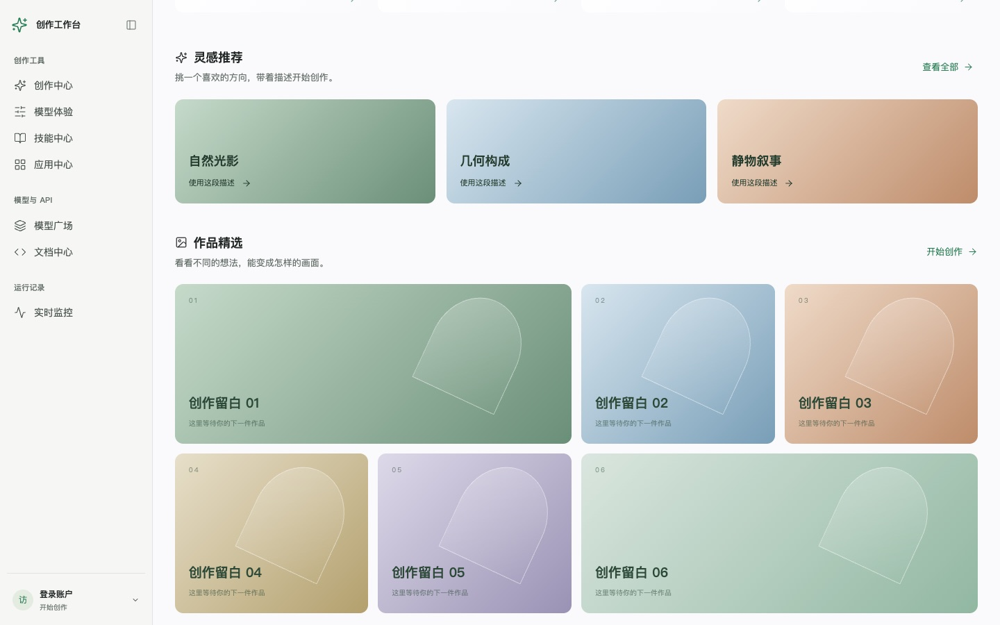 |  |

**创作工作台**：左侧选类型、模型、尺寸和参考图，中间写描述并查看结果，右侧是创作记录。

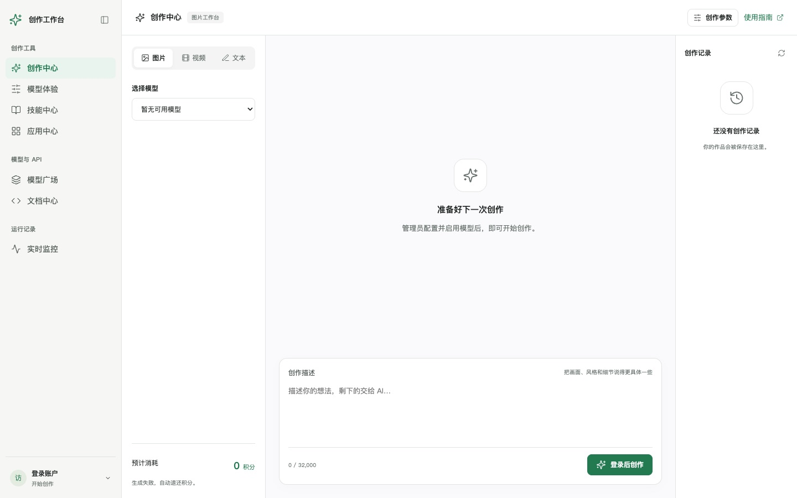

| 模型广场 | 文档中心 |
|---|---|
| 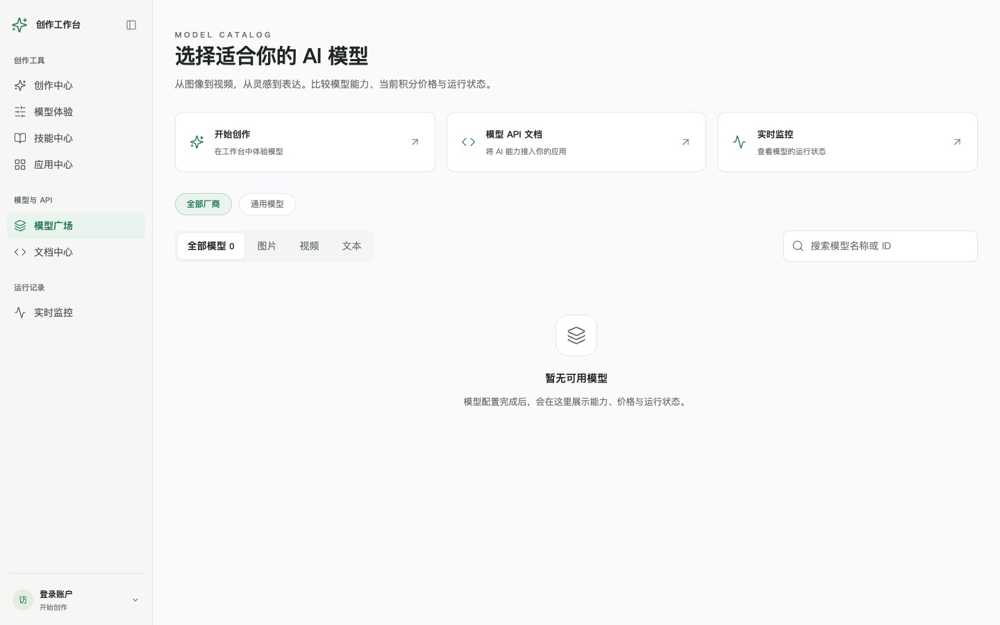 | 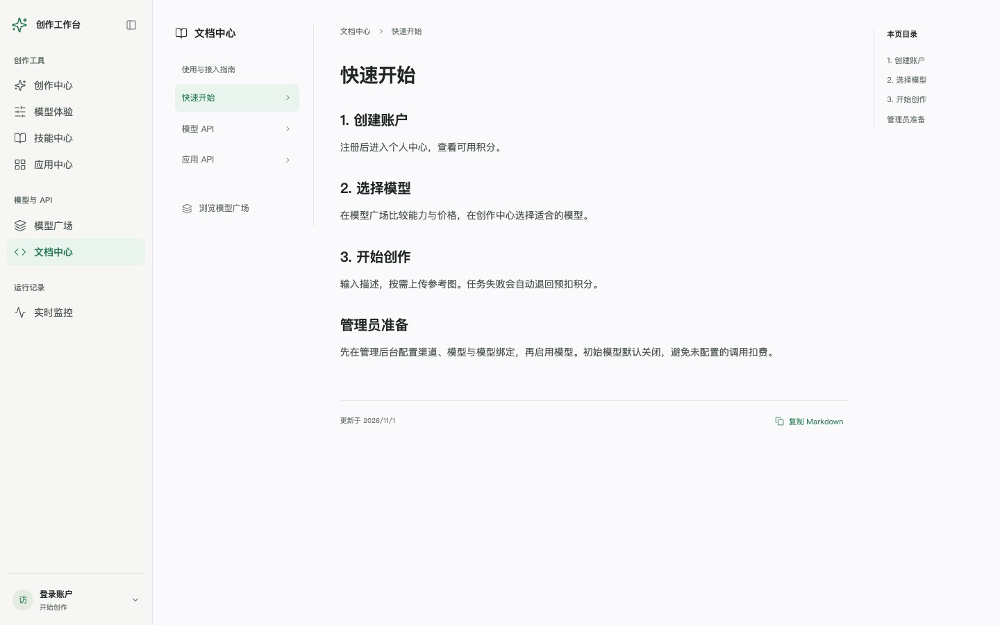 |

| 实时监控 | 用户中心 |
|---|---|
| 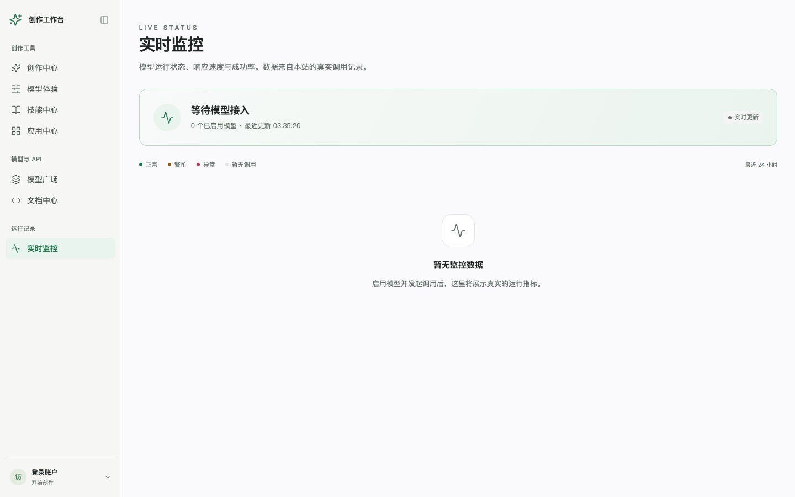 | 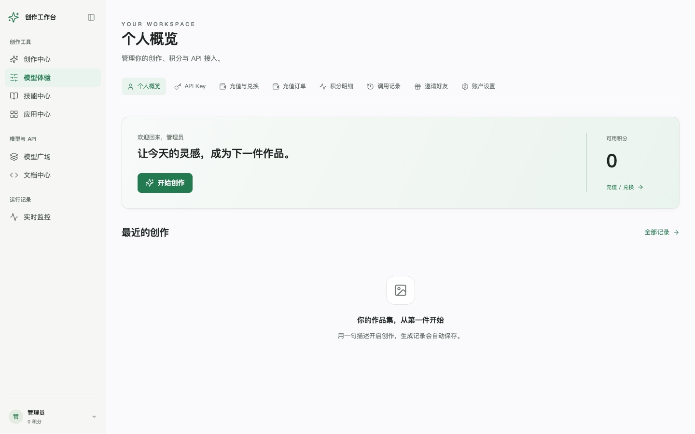 |

### 管理后台（`/admin`）

**数据概览**：今日生成、累计成功、确认收入、新用户，近 7 天趋势和渠道状态。

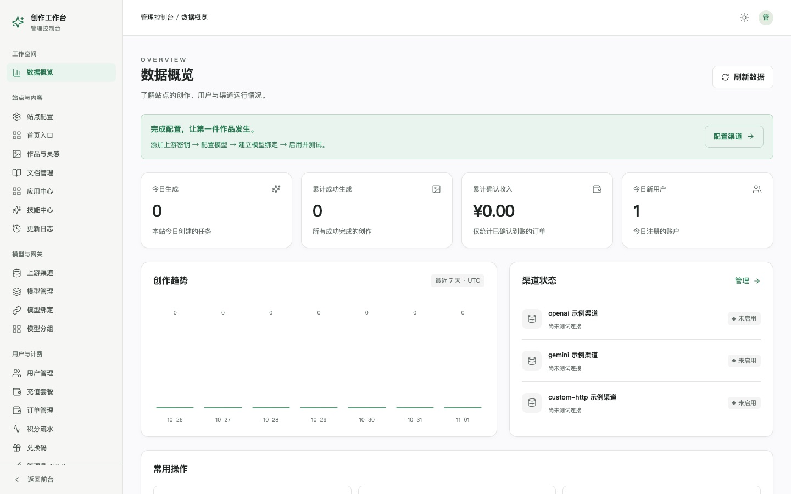

**上游渠道**：在这里填写服务商的 Base URL、密钥和协议，可以一键测试连通性。密钥加密存储，列表里不显示原文。

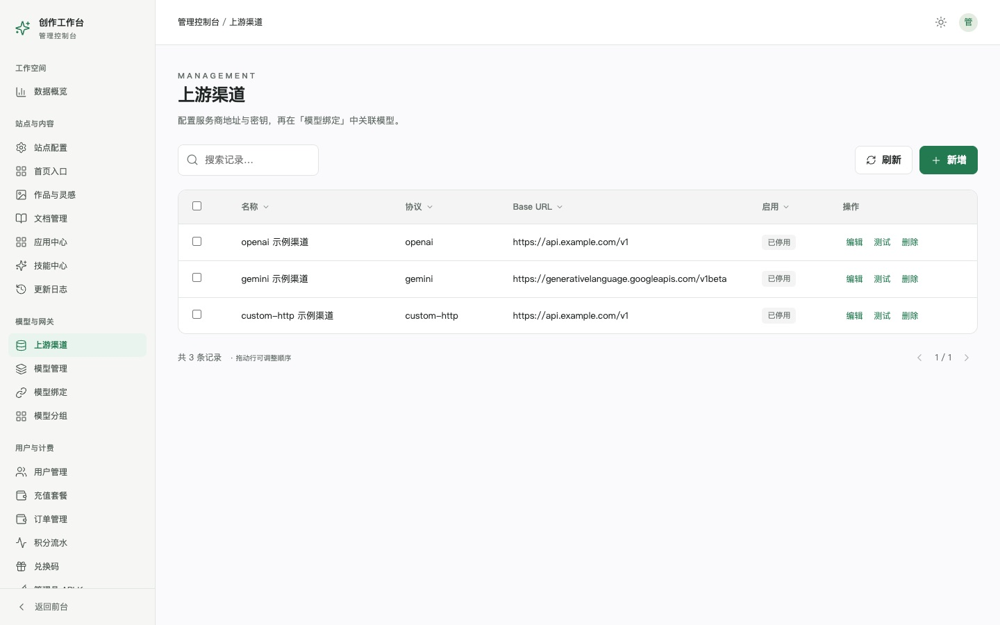

| 模型管理 | 模型绑定（模型 → 渠道 → 上游模型名） |
|---|---|
| 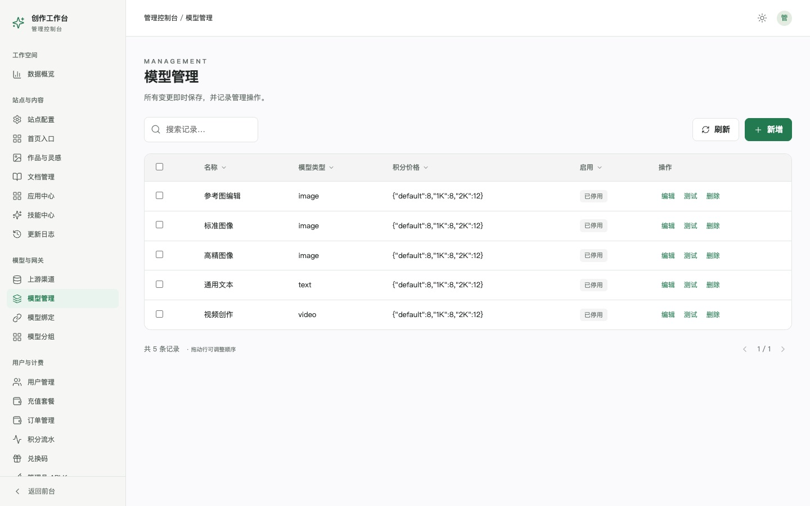 | 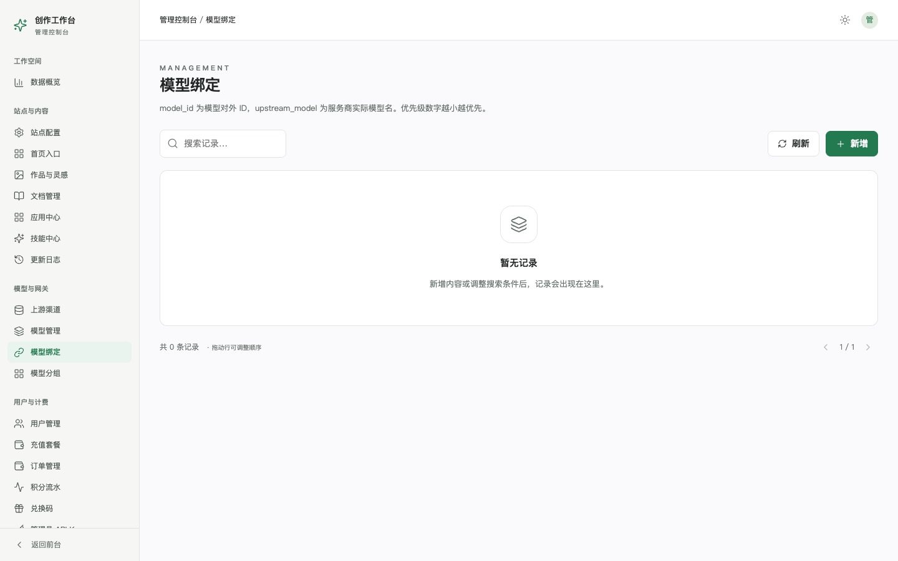 |

| 站点配置 | 作品与灵感 |
|---|---|
| 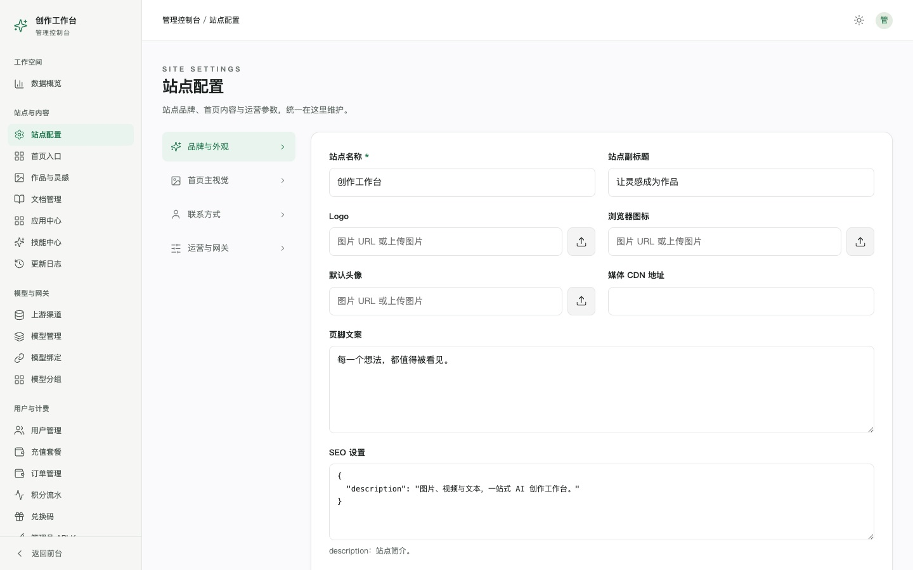 | 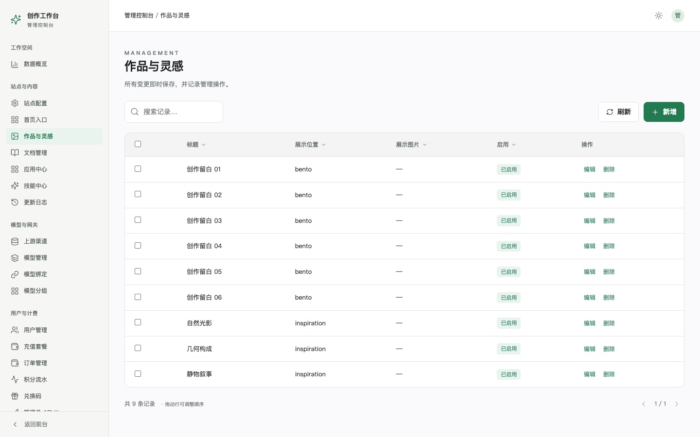 |

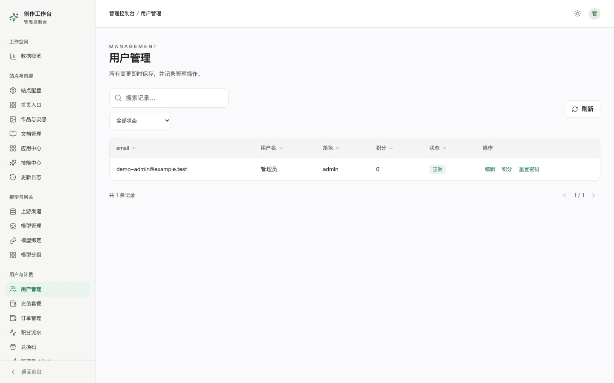

---

## 技术架构

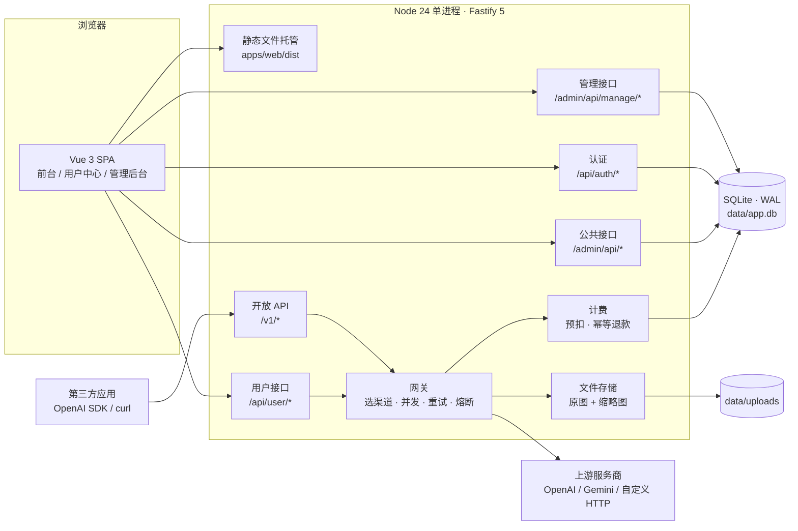

### 一次生成请求的流程

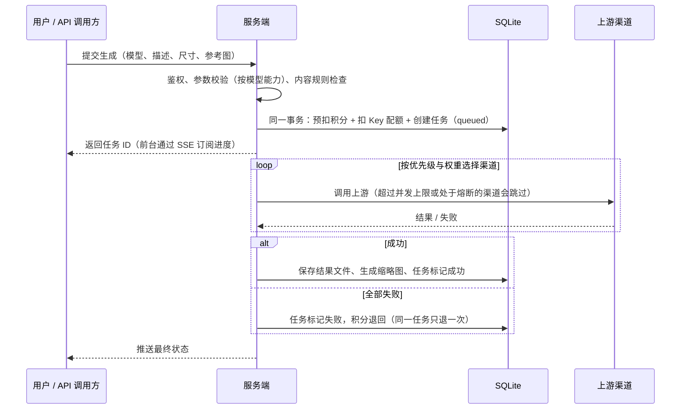

### 技术栈

| 层 | 选型 |
|---|---|
| 前端 | Vue 3.5、Vite、TypeScript、Vue Router、Pinia；原生 CSS 变量做设计令牌（浅色 / 深色两套），图标用 lucide |
| 后端 | Node 24、Fastify 5（cookie、multipart、rate-limit、static 插件） |
| 数据库 | SQLite（better-sqlite3，开启 WAL 和外键）+ Drizzle ORM；版本化 SQL 迁移在启动时自动执行 |
| 安全 | 密码用 Argon2；Session 和 API Key 只存哈希；渠道密钥用 AES-256-GCM 加密；登录、注册、生成接口限流 |
| 文件 | 本地磁盘存储，sharp 生成缩略图；私有文件需要所有者登录，或使用 7 天有效的签名链接 |
| 共享代码 | `packages/shared`：zod schema 与类型，前后端共用 |
| 测试 | Vitest（集成测试）、Playwright（HTTP 端到端）、本地模拟上游服务 |

---

## 快速开始

需要 Node 24 和 pnpm 10（通过 corepack 使用）。

```bash
corepack pnpm install
```

```bash
cp .env.example .env
```

编辑 `.env`：

| 变量 | 说明 |
|---|---|
| `PORT` / `HOST` | 监听端口和地址，默认 `3000` / `0.0.0.0` |
| `DATA_DIR` | 数据目录（SQLite 和上传文件），**推荐写绝对路径** |
| `APP_SECRET` | 32 个字符以上，用来加密渠道密钥和签名链接。**上线后不能更换**，否则已保存的渠道密钥无法解密 |
| `ADMIN_EMAIL` / `ADMIN_PASSWORD` | 首次启动时创建的管理员账号，密码至少 12 位。管理员已存在时不会被重置 |
| `PUBLIC_BASE_URL` | 站点对外地址，用于生成结果文件的链接 |

初始化数据库并启动开发环境：

```bash
corepack pnpm db:migrate
```

```bash
corepack pnpm db:seed
```

```bash
corepack pnpm dev
```

- 前端开发服务器：<http://127.0.0.1:5173>（接口会代理到后端）
- 后端：<http://127.0.0.1:3000>
- 管理后台：<http://127.0.0.1:5173/admin>，用 `.env` 里的管理员账号登录

生产构建与运行：

```bash
corepack pnpm build
```

```bash
corepack pnpm start
```

`start` 由同一个进程提供网页和接口，访问 `http://<HOST>:<PORT>` 即可。

---

## 配置第一个可用模型

示例渠道和模型默认都是关闭的，新用户注册赠送积分为 0。项目不提供虚构的生成结果或统计数据，所以只有配置好真实的服务商密钥后才能生成作品。

1. **上游渠道**（`/admin/gateway`）：新增渠道，填写 Base URL、密钥，选择协议，然后启用并点「测试」。
   - OpenAI 兼容服务的地址通常以 `/v1` 结尾；
   - Gemini 的地址通常以 `/v1beta` 结尾。
2. **模型管理**（`/admin/models`）：编辑示例模型或新建模型，填写对外 ID、名称、类型（图片 / 视频 / 文本）、支持的比例和分辨率、是否支持参考图，以及每个分辨率的积分价格。
3. **模型绑定**（`/admin/model-channels`）：选择模型和渠道，填写上游的真实模型名。优先级数字越小越先尝试，同一优先级内按权重分配。一个模型可以绑定多个渠道，失败时会自动换下一个。
4. **启用模型**，然后在「用户管理」里给测试账户加积分，或在「兑换码」里生成兑换码让用户自己兑换。模型的「测试」按钮也按正常价格扣积分。

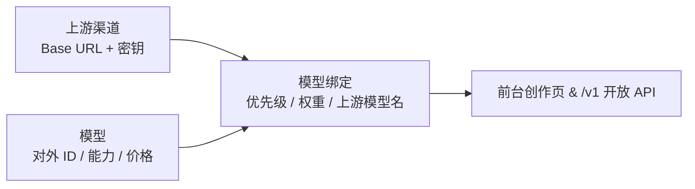

---

## 自定义 HTTP 协议

不在内置协议里的服务商，可以把渠道协议选成 `custom-http`，在渠道的高级配置里描述请求和响应的格式，不用改代码。

可用变量：`{{prompt}}`、`{{model}}`、`{{size}}`、`{{ratio}}`、`{{resolution}}`、`{{duration}}`、`{{images}}`。如果某个字段的值只有一个变量，会保留它原本的数组或数字类型。

**同步接口示例：**

```json
{
  "path": "/images/generations",
  "body": { "model": "{{model}}", "prompt": "{{prompt}}", "size": "{{size}}" },
  "response_path": "$.data[*].url"
}
```

**异步任务**（视频等）还需要配置：

| 字段 | 作用 |
|---|---|
| `task_id_path` | 从提交结果里取任务 ID |
| `poll_path` | 轮询地址，如 `/tasks/{{task_id}}` |
| `status_path` | 从轮询结果里取状态 |
| `success_value` / `error_value` | 表示成功 / 失败的状态值 |

结果提取支持 `$`、属性名、数组下标和 `[*]`，不执行脚本或任意 JSONPath 表达式。生成的文件保存在本站存储里。

---

## 开放 API

用户在「API Key」页面创建 Key，每个 Key 可以限制允许的模型和积分配额。所有接口都使用：

```
Authorization: Bearer sk-...
```

| 方法 | 路径 | 说明 |
|---|---|---|
| GET | `/v1/models` | 可用模型列表 |
| POST | `/v1/images/generations` | 图片生成，`response_format` 支持 `url` 和 `b64_json`，每次 1 张 |
| POST | `/v1/images/edits` | 图片编辑，multipart，字段 `image` 或 `image[]` |
| POST | `/v1/chat/completions` | 文本对话，支持 `stream: true`（SSE） |
| POST | `/v1/videos/generations` | 提交视频任务 |
| GET | `/v1/videos/:id` | 查询视频任务 |

**curl 示例：**

```bash
curl http://127.0.0.1:3000/v1/images/generations -H "Authorization: Bearer sk-xxx" -H "Content-Type: application/json" -d '{"model":"你的模型ID","prompt":"一只戴草帽的猫","size":"1024x1024"}'
```

**OpenAI SDK 示例：**

```ts
import OpenAI from 'openai';

const client = new OpenAI({ apiKey: 'sk-xxx', baseURL: 'http://127.0.0.1:3000/v1' });
const img = await client.images.generate({ model: '你的模型ID', prompt: '一只戴草帽的猫' });
console.log(img.data[0].url);
```

### 公共接口（前台使用，无需登录）

| 路径 | 内容 |
|---|---|
| `/admin/api/site` | 站点配置（不含敏感字段） |
| `/admin/api/stats` | 生成总数、平均耗时等统计 |
| `/admin/api/managed-models` | 已启用的模型（不含渠道信息） |
| `/admin/api/showcase` | 作品精选与灵感推荐 |
| `/healthz` | 健康检查 |

---

## 数据与计费

- 用户、会话、密钥、订单、兑换码、积分流水、任务、文件等业务数据用明确的字段建表；首页入口、文档、应用等可配置内容按资源分表，内容存成 JSON。
- 表结构定义在 `apps/server/src/db/schema.ts`，版本化迁移在 `apps/server/src/db/index.ts`，启动时自动执行。种子数据只在空站点时创建一次。
- **扣积分、扣 API Key 配额和创建任务在同一个事务里提交**；失败退款靠状态约束和唯一流水索引保证只退一次。
- 进程重启后，还在排队的任务会继续执行。已经发给上游、但被中断的请求**不会自动重发**（避免服务商重复收费），而是退回积分并提示用户重试。
- **充值**：用户先创建待确认订单，管理员收到款项后在后台确认到账；重复确认不会重复加积分。
- **邀请奖励**：受邀用户第一次充值被确认后，给邀请人发放一次奖励。

---

## 测试

```bash
corepack pnpm lint
```

```bash
corepack pnpm typecheck
```

```bash
corepack pnpm test
```

```bash
corepack pnpm test:e2e
```

- `test`：17 项集成测试，在临时数据库里验证网关、认证、计费、退款和重启恢复。
- `test:e2e`：启动独立的临时应用和模拟上游，用真实 HTTP 请求跑通「注册 → 兑换 → 生成 → 查看流水」、管理后台增删改查，以及 OpenAI SDK 调用。
- 测试数据和正式数据库完全隔离。浏览器交互、手机端和深色模式的检查记录见 [docs/ACCEPTANCE.md](docs/ACCEPTANCE.md)。

> 如果你本机的 pnpm 版本与 `packageManager` 字段（10.28.2）不一致，`typecheck` 里的 `pnpm -r` 可能报版本错误。可以在各个包目录里分别执行 `corepack pnpm run typecheck`，或者把 pnpm 切到 10.28.2。

---

## Docker 部署

```bash
mkdir -p data && sudo chown -R 1000:1000 data
```

准备 `.env`：填写新的 `APP_SECRET`、`ADMIN_EMAIL`、`ADMIN_PASSWORD`，`PUBLIC_BASE_URL` 填实际访问地址。然后：

```bash
docker compose up -d --build
```

```bash
curl -f http://127.0.0.1:3180/healthz
```

- 容器以非 root 用户运行，根文件系统只读，只能写挂载的 `data/` 目录。
- 端口只监听 `127.0.0.1:3180`，由 Nginx 转发。配置示例见 `deploy/nginx-ip.conf`。
- 更新：保留 `.env` 和 `data/`，更新源码后再执行一次 `docker compose up -d --build`。
- 管理员创建后，环境变量不会重置已有管理员的密码，以后在个人设置里修改。

线上服务器的部署细节见 [docs/DEPLOYMENT.md](docs/DEPLOYMENT.md)。

---

## 备份与恢复

```bash
docker compose exec -T app node scripts/backup.mjs
```

- 使用 SQLite 的在线备份 API，快照保存在 `data/backups/`，保留最近 14 份。
- `deploy/creation-studio-backup.timer` 和 `.service` 可以配置成每天自动备份。
- 备份脚本**只备份数据库**。`data/uploads/`（上传和生成的文件）和 `.env` 要另外备份到安全的位置。
- **恢复**：先停止应用并保留当前数据库副本；把选定的备份替换为 `data/app.db`，删除旧的 `app.db-wal` 和 `app.db-shm`，然后启动并检查 `/healthz`。

---

## 项目结构

```
.
├── apps/
│   ├── web/                    # Vue 3 前端
│   │   ├── src/
│   │   │   ├── styles/         # tokens.css（设计令牌，浅色 / 深色）、base.css
│   │   │   ├── layouts/        # PublicShell（前台侧栏）、AdminShell（后台）
│   │   │   ├── components/     # DataTable、FieldEditor、BaseModal、MarkdownContent…
│   │   │   ├── views/public/   # Home、Create、ModelSquare、Docs、Status、Content、Login
│   │   │   ├── views/user/     # UserCenter
│   │   │   ├── views/admin/    # Overview、SiteConfig、ResourceManager（通用资源管理页）
│   │   │   ├── router/         # 路由与登录 / 管理员守卫
│   │   │   ├── stores/         # Pinia：站点、主题、登录状态
│   │   │   └── api/            # 请求封装
│   │   └── e2e/                # Playwright HTTP 端到端测试
│   └── server/                 # Fastify 后端
│       ├── src/
│       │   ├── db/             # schema、迁移、种子数据、命令行
│       │   ├── routes/         # public、auth、user、admin、v1
│       │   └── services/       # gateway（适配器与调度）、billing、storage、security
│       └── test/               # 集成测试与模拟上游
├── packages/shared/            # 前后端共用的 zod schema 与类型
├── scripts/backup.mjs          # SQLite 在线备份
├── deploy/                     # Nginx 配置、systemd 定时备份
├── docs/
│   ├── PLAN.md                 # 技术方案
│   ├── ACCEPTANCE.md           # 实施与验收记录
│   ├── DEPLOYMENT.md           # 服务器部署说明
│   └── images/                 # README 截图
├── Dockerfile
└── docker-compose.yml
```

以下内容不进入 git（见 `.gitignore`）：`.env`、`data/`、`.deploy/`（本地管理员信息）、`docs/ref/`（参考站截图）、`docs/qa/`（验收截图）、`node_modules/`、`dist/`、测试报告。

---

## 相关文档

- [docs/PLAN.md](docs/PLAN.md)：技术架构与实施方案（设计令牌、数据库表、接口、任务拆分）
- [docs/ACCEPTANCE.md](docs/ACCEPTANCE.md)：实施与验收记录
- [docs/DEPLOYMENT.md](docs/DEPLOYMENT.md)：服务器部署与运维

---

## 当前状态与已知问题

**尚未完成的验收**（详见 [ACCEPTANCE.md](docs/ACCEPTANCE.md)）：

- **真实上游**：还没有填写服务商密钥，真实的图片、文本、视频调用都没有验证过。
- **像素级对比**：已完成多尺寸截图和布局检查，但与参考站逐像素对比（差异 ≤ 0.5%）的验收还没有做。
- **Lighthouse 分数**：还没有拿到有效分数。
- **二期功能**：团队、代理商分站和在线支付不在一期范围内。

**本次检查中发现的界面问题**（未修复）：

- 首页大标题右下方的装饰文字「A SPACE FOR YOUR IDEAS」被输入框挡住了一半（浅色和深色都有）。
- 后台「模型管理」列表的「积分价格」一列直接显示 JSON 原文（如 `{"default":8,"1K":8,"2K":12}`），可读性差。
- 后台侧栏最后一项「管理员 API Key」在 900px 高的窗口里被底部的「返回前台」挡住一部分，需要滚动才能看全。
